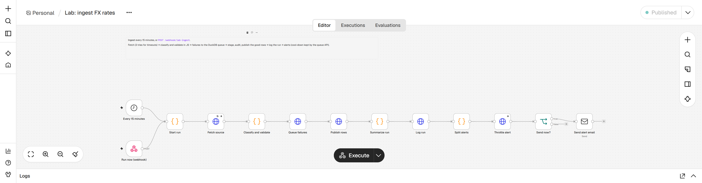
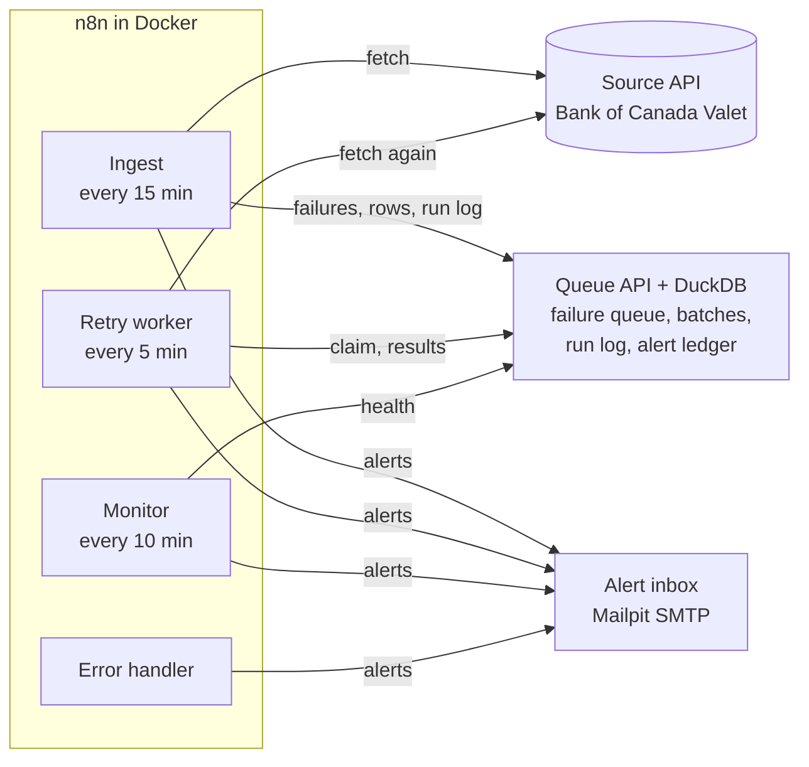
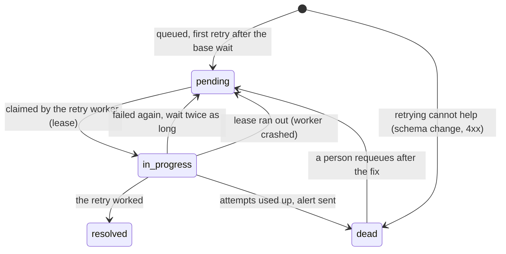
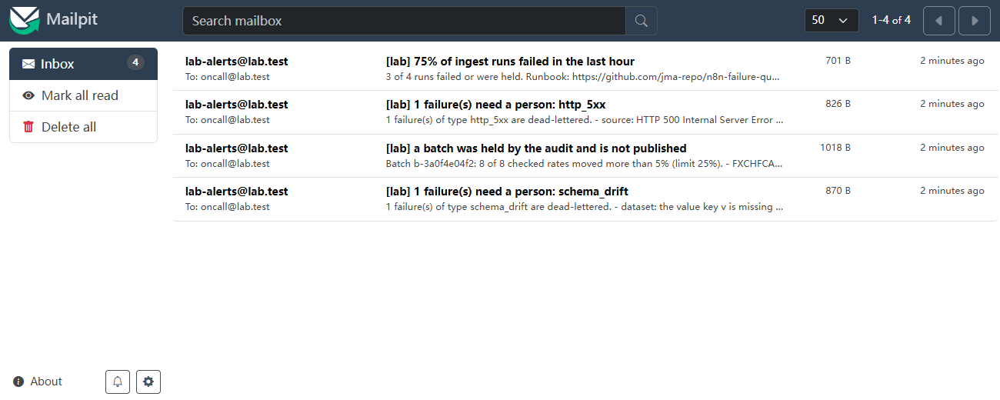
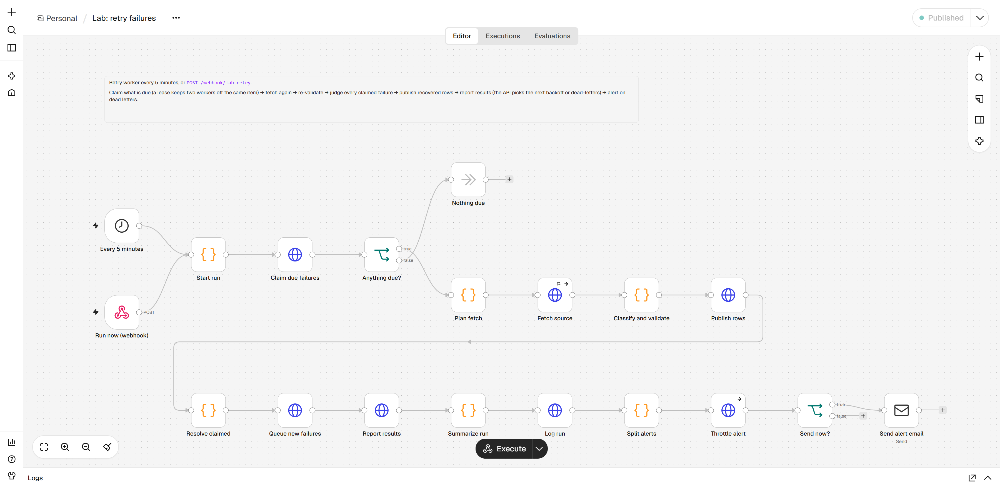

# n8n failure-queue lab

An n8n workflow that pulls a public API on a schedule, validates every field, and **never loses a failure**: bad records go
to a DuckDB failure queue, are retried with exponential backoff, and raise an alert when the retries run out. A set of SQL
queries (CTEs, window functions) then explains *why* things failed, and a runbook tells whoever gets the alert what to do.

Everything runs locally with free software (n8n Community, DuckDB, Mailpit, Docker) and the real **Bank of Canada Valet API**
as the source. See [open-source choices](docs/open-source-choices.md) for what replaces the paid tools such roles mention.



## What it demonstrates

| Skill | Where to look |
|---|---|
| **n8n workflows** with triggers, retries, error handling, branching, Code nodes and email | four workflows in [`n8n/workflows/`](n8n/workflows), generated from [`src/lab/workflows`](src/lab/workflows) |
| **QA thinking**: edge cases, monitoring, rollback | a validator tested on dozens of edge cases (BOMs, comma decimals, duplicate rows, weekend dates, renamed fields), write-audit-publish with hold and rollback, a monitor that alerts on *silence*, alerts that fail open, 16 end-to-end scenarios |
| **SQL troubleshooting** | eight [root-cause queries](docs/rca-report.md) found the scripted incidents blind |
| **Operations** | a [runbook](docs/runbook.md) with a playbook per error type, checked by tests against the code |

## How it works



**Why a small API in front of DuckDB.** DuckDB is embedded with a single writer and n8n has no DuckDB node, so one service owns the
file. n8n stays the orchestrator (fetch, validate, route, alert) and the queue logic (what is due, when to retry, whether to alert)
lives in SQL and Python where it can be unit-tested with a fake clock. [More on the trade-offs](docs/design-decisions.md).

### The life of a failure



- **One problem, one queue item.** Failures are keyed by error type and scope (`out_of_range` + `FXJPYCAD@2026-11-04`), so 68 runs
  that saw the same schema change are one item with `occurrences = 68`, not 68 rows.
- **Retry budgets per error type** ([`config/error_taxonomy.yaml`](config/error_taxonomy.yaml)): a 5xx gets 6 retries over about an
  hour; a schema change gets none, because retrying cannot fix it. `Retry-After` is honoured. Equal jitter keeps retries from
  arriving together.
- **A lease** locks a claimed failure to one worker, so two overlapping retry runs never work the same item (tested with two real
  concurrent n8n executions).
- **Write, audit, publish.** Good rows are staged and audited (a window function compares each rate with the previous day). If more
  than a quarter of the series moved more than 5%, the batch is **held** and never becomes visible; a person approves it, or the
  source corrects itself. A published batch can be **rolled back**: the view shows the previous version again, nothing is overwritten.
- **Alerts are cheap to trust.** Each alert key is muted for a cool-down (15 min critical, 60 min warning), and they **fail open**: if
  the queue API is down, n8n's error workflow still sends the email (there is a test for exactly that).
- **Silence is a failure.** The monitor alerts when no ingest has succeeded for 45 minutes, which no per-run check can see.





## Quick start

Needs Docker (Desktop, Engine or Podman), [uv](https://docs.astral.sh/uv/) and about 3 GB of disk for the images.

```bash
uv sync
uv run lab init            # writes .env with random secrets (git-ignored)
uv run lab up              # builds, starts, creates the n8n owner, imports and publishes the workflows
```

Then open n8n at <http://localhost:5678> (owner email and password are in `.env`) and the alert inbox at <http://localhost:8025>.

Break something and watch it recover:

```bash
uv run lab reset --fast                  # empty warehouse; retry delays 100x shorter
uv run lab chaos http_500 --first-n 2    # the source fails its next two requests
uv run lab trigger ingest                # a run fails, the failure is queued
uv run lab trigger retry                 # repeat: waits grow, then the retry succeeds
uv run lab status                        # health, open failures, held batches
uv run lab sql "SELECT * FROM failure_events ORDER BY event_id"
```

Faults the stand-in source can inject: `http_500`, `http_503`, `http_404`, `rate_limit`, `timeout`, `slow`, `truncated`, `html`,
`empty`, `schema_drift`, `missing_series`, `null_values`, `bad_type`, `out_of_range`, `duplicates`, `stale`, `jump`, `bad_date`.
Each can be partial (`--p 0.3`), self-ending (`--ttl 60`) or short-lived (`--first-n 2`).

**Live mode.** Put `LAB_SOURCE_BASE=https://www.bankofcanada.ca` in `.env` and run `uv run lab up` to ingest the real exchange rates
(USD, EUR, GBP, JPY, CNY, AUD, CHF, MXN against CAD). The Bank publishes once a day around 16:30 Eastern and its terms forbid
circumventing request limits, so one request per run at the default 15-minute schedule is already generous.

## SQL root-cause analysis

[`sql/rca/`](sql/rca) holds eight queries over the failure ledger. They run on **two weeks of simulated operations** (seed 7: 1,344
ingest runs, six scripted incidents) replayed through the same store the live stack uses, and a test checks that they find the
incidents without ever reading the script. The full output, with each query's SQL, is in [`docs/rca-report.md`](docs/rca-report.md).

| Query | Technique | What it found |
|---|---|---|
| 01 failure rate by type | CTE denominator, `RANK`, running share | schema drift is half of all failing runs; four types make 96% |
| 02 failure rate by hour | `generate_series` time spine, window baseline | **07:00 UTC fails 54% of the time against 10% overall, on all 14 days**: a maintenance window on the source's side, not an incident |
| 03 daily trend | named windows, `RANGE` frames, median baseline | four spike days; a median baseline still flags the null-value day that an average would hide |
| 04 incidents | gaps and islands with `LAG` | a 210-minute outage whose first alert came 65 minutes in (alerts fire when retries run out); a 17.5-hour schema change alerted at once |
| 05 error patterns | window `LAG`, `arg_max` | timeouts are chronic (14 of 14 days); everything else is episodic or a one-off |
| 06 retry effectiveness | `FILTER`, `quantile_cont`, `ROLLUP` | 22 of 25 failures healed alone, 2 needed a person, 1 is still dead (a null-value item nobody requeued) |
| 07 backoff audit | `LAG` over each ledger, quantiles | 62 retries, none fired early, none outside the policy's envelope, p95 lateness 269 s (the worker polls every 5 minutes) |
| 08 post-mortem | range joins, `mode`, taxonomy join | one row per cause with who had to act: this is the table for the review meeting |

Reproduce: `uv run lab history && uv run lab rca --markdown docs/rca-report.md`. Against the live warehouse use `uv run lab sql "..."`
(read-only, one SELECT).

## The runbook

[`docs/runbook.md`](docs/runbook.md) covers what runs where, what healthy looks like, the first five minutes after an alert, a
playbook for each of the 17 error types, rollback and replay, and a post-incident template. `tests/test_runbook.py` fails if an
error type has no playbook or a playbook quotes a retry budget that differs from the taxonomy.

## Tests

```bash
uv run pytest                      # store, API, source, RCA, workflows, runbook (end-to-end tests are skipped)
node --test "tests/js/*.test.js"   # validator edge cases, retry judging, alert wording, a compile check of every Code node
uv run lab e2e                     # 16 scenarios against the running stack, about four minutes
```

The end-to-end suite runs real n8n executions: a source that recovers after two failures, one that stays down until the retries
run out (the waits are asserted: 0.3, 0.6, 1.2, 2.4, 4.8, 9.6 s at the demo time scale), a schema change, four kinds of bad cell, a
stale feed, `Retry-After`, a hanging source, a jump the audit holds, the monitor's silence alert and its cool-down, two retry workers
at once, a queue API outage during an ingest, and a requeue after a fix. It found two real bugs while it was written (a tie on
equal timestamps decided which version was visible; a duplicate identifier made the error handler's Code node fail to compile),
and both now have tests that fail without the fix.

## What is real and what is simulated

- **Real:** n8n 2.46 in Docker, every workflow, the DuckDB queue, the retries, the alerts (to a local SMTP sink), and, in live
  mode, the Bank of Canada data.
- **Simulated:** the default source is a stand-in that mimics the Valet API's shape and can misbehave on command; the two weeks
  of history behind the RCA are scripted. The incident timeline is invented. Nothing here is a real company's data or outage.
- **Not built:** high availability, authentication beyond a shared API key (it is a lab on `127.0.0.1`), a real alert relay, and
  Workato itself (it has no free tier; [the concepts map to n8n](docs/open-source-choices.md#workato-concepts-in-this-lab)).

## Layout

```
config/error_taxonomy.yaml   error types: retry budget, severity, runbook anchor (one source of truth)
n8n/code/                    the JavaScript inside the Code nodes (validator, alert wording, health rules)
n8n/workflows/               generated n8n workflow JSON (committed; rebuilt by scripts/build_workflows.py)
src/lab/queue_api/           the failure queue: DuckDB store, backoff, write-audit-publish, HTTP API
src/lab/source_sim/          the stand-in source and its eighteen faults
src/lab/history/             the two-week simulation behind the RCA
src/lab/workflows/           Python that builds the workflow JSON
sql/schema.sql, sql/rca/     the warehouse schema and the eight root-cause queries
docs/                        runbook, RCA report, design decisions, open-source choices, screenshots
tests/, tests/js/, tests/e2e/
```

## Data and terms

Live mode uses the Bank of Canada Valet API under the Bank's [terms of use](https://www.bankofcanada.ca/terms/) (attribution, accuracy,
no circumvention of request limits): *Source: Bank of Canada*. This project is independent and not endorsed by the Bank. n8n is used
under its Sustainable Use License (self-hosted, internal use). Code: MIT, see [LICENSE](LICENSE).
